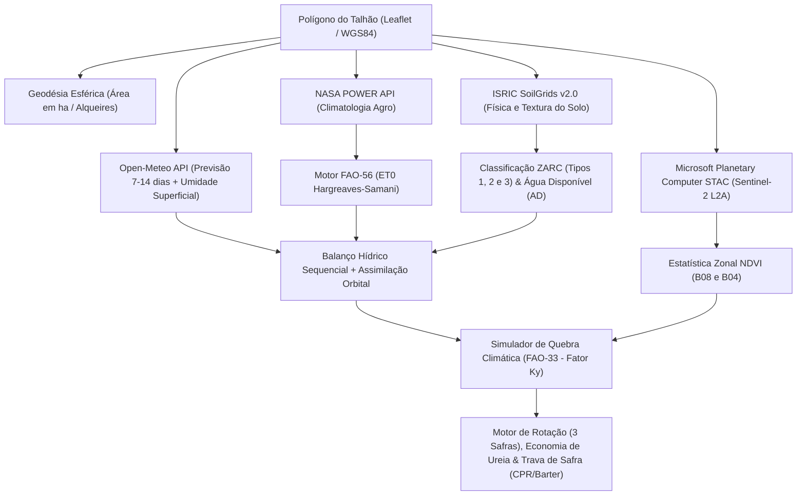

# 🔬 Documentação Técnica e Embasamento Científico — AgroCycle AI

Este documento detalha de ponta a ponta **como todos os dados são extraídos**, **quais sistemas e APIs orbitais/meteorológicas são utilizados**, **todas as fórmulas matemáticas implementadas no código** ([`agronomic-engine.js`](./backend/engine/agronomic-engine.js), [`orbital-services.js`](./backend/engine/orbital-services.js), [`presets.js`](./backend/engine/presets.js), [`ui.js`](./frontend/js/ui.js) e [`main.py`](./backend/api/main.py)) e o respectivo **embasamento científico e normativo**.

---

## 1. Arquitetura do Fluxo de Dados (Pipeline Orbital → Motor Biofísico → Decisão)

---

## 2. Sistemas Utilizados e Extração de Dados

O sistema opera em arquitetura **Offline-First Híbrida**: realiza chamadas assíncronas em tempo real com controle de *timeout* (`AbortController`), cache em `localStorage` e *fallbacks* determinísticos calibrados por região.

### 2.1. NASA POWER API (Climatologia Agrometeorológica)
- **Função no código**: [`fetchNasaPowerClimatology`](./backend/engine/orbital-services.js#L126-L164)
- **Endpoint**:
  `https://power.larc.nasa.gov/api/temporal/climatology/point?parameters=T2M,T2M_MIN,PRECTOTCORR,ALLSKY_SFC_SW_DWN&community=AG&longitude={lon}&latitude={lat}&format=JSON`
- **Comunidade**: `AG` (*Agroclimatology*)
- **Variáveis extraídas**:
  1. `T2M` (`ANN`): Temperatura média anual do ar a 2 metros de altura ($\text{°C}$).
  2. `T2M_MIN` (`JAN`..`DEC`): Temperatura mínima mensal a 2 metros ($\text{°C}$), da qual se extrai o mínimo absoluto anual ($\min(T_{\min,\text{mês}})$) para avaliar risco de geada e aptidão de culturas de inverno.
  3. `PRECTOTCORR` (`ANN`): Precipitação média diária corrigida ($\text{mm}\cdot\text{dia}^{-1}$), convertida para acumulado anual multiplicando-se por $365$:
     $$P_{\text{anual}} = \text{round}\left(\text{PRECTOTCORR}_{\text{ANN}} \times 365\right)$$
  4. `ALLSKY_SFC_SW_DWN` (`ANN`): Irradiação solar global incidente na superfície em céu total ($\text{MJ}\cdot\text{m}^{-2}\cdot\text{dia}^{-1}$).
- **Mecanismo de Fallback Regional**: Caso a API exceda $6{,}5\text{ s}$ ou haja perda de conectividade, aplica-se interpolação latitudinal sobre o preset regional mais próximo ($\Delta \text{lat} = \text{lat} - \text{lat}_{\text{preset}}$):
  $$T_{\text{est}} = T_{\text{preset}} + 0{,}35 \cdot \Delta \text{lat}, \quad T_{\min,\text{est}} = T_{\min,\text{preset}} + 0{,}45 \cdot \Delta \text{lat}$$

---

### 2.2. Microsoft Planetary Computer STAC & Data API (Sentinel-2 L2A)
- **Função no código**: [`fetchPlanetaryComputerNDVI`](./backend/engine/orbital-services.js#L38-L124) e [`renderNdviMapLayer`](./frontend/js/ui.js#L194-L225)
- **Satélite / Coleção**: Constelação Copernicus **Sentinel-2 (MSI)** nível `sentinel-2-l2a` (*Bottom-Of-Atmosphere Surface Reflectance* — refletância de superfície corrigida atmosfericamente).
- **Etapa 1 — Busca Espaço-Temporal (STAC Search)**:
  - **Endpoint**: `POST https://planetarycomputer.microsoft.com/api/stac/v1/search`
  - **Filtros**: Polígono GeoJSON desenhado pelo usuário (`intersects`), janela de $180\text{ dias}$ até a data atual, cobertura de nuvens `eo:cloud_cover < 45%`, ordenado pela cena mais recente (`datetime desc`).
- **Etapa 2 — Estatística Zonal de NDVI no Polígono**:
  - **Endpoint**: `POST https://planetarycomputer.microsoft.com/api/data/v1/item/statistics`
  - **Bandas espectrais**:
    - `B08` (Infravermelho Próximo — NIR, $\lambda \approx 842\text{ nm}$, resolução $10\text{ m}$)
    - `B04` (Vermelho — Red, $\lambda \approx 665\text{ nm}$, resolução $10\text{ m}$)
  - **Expressão algébrica enviada ao servidor**: `(B08-B04)/(B08+B04)` recortada exatamente pela geometria do talhão, retornando a média zonal (`bandStats.mean`) limitada ao intervalo $[-0{,}10;\; 0{,}95]$.
- **Etapa 3 — Renderização de Tiles Raster WebMercatorQuad**:
  - **Endpoint**: `https://planetarycomputer.microsoft.com/api/data/v1/item/tiles/WebMercatorQuad/{z}/{x}/{y}@1x` com `colormap_name=rdylgn` e `rescale=-0.1,0.85`.

---

### 2.3. ISRIC SoilGrids v2.0 (Propriedades Físico-Hídricas do Solo)
- **Função no código**: [`bonusFetchSoilProperties`](./backend/engine/orbital-services.js#L166-L210)
- **Endpoint**: `GET https://rest.isric.org/soilgrids/v2.0/properties/query`
- **Camadas consultadas**: `0-5cm` e `5-15cm` (estatística `mean`).
- **Propriedades extraídas e conversão pelo fator de escala (`d_factor`)**:
  1. `clay`: Teor de argila ($\text{g/kg} \div 10 \rightarrow \%$ em massa).
  2. `sand`: Teor de areia ($\text{g/kg} \div 10 \rightarrow \%$ em massa).
  3. `wv0033` ($\theta_{\text{CC}}$ ou $\text{VWC}_{33}$): Umidade volumétrica na **Capacidade de Campo** a $33\text{ kPa}$ ($\text{cm}^3\cdot\text{cm}^{-3}$).
  4. `wv1500` ($\theta_{\text{PMP}}$ ou $\text{VWC}_{1500}$): Umidade volumétrica no **Ponto de Murcha Permanente** a $1500\text{ kPa}$ ($\text{cm}^3\cdot\text{cm}^{-3}$).

---

### 2.4. Open-Meteo Forecast & Soil Moisture API
- **Função no código**: [`bonusFetchWeatherData`](./backend/engine/orbital-services.js#L212-L283)
- **Endpoint**: `GET https://api.open-meteo.com/v1/forecast`
- **Variáveis extraídas** (`timezone=America/Sao_Paulo`):
  1. `daily=precipitation_sum`: Precipitação diária acumulada ($\text{mm}$).
  2. `daily=et0_fao_evapotranspiration`: Evapotranspiração de referência diária Penman-Monteith FAO-56 ($\text{mm}\cdot\text{dia}^{-1}$).
  3. `hourly=soil_moisture_0_to_7cm`: Umidade volumétrica superficial do solo ($\text{m}^3\cdot\text{m}^{-3}$) agregada pela média aritmética das 24 horas de cada dia.

---

### 2.5. Mapas Base (Esri ArcGIS Online)
- **Função no código**: [`initMap`](./frontend/js/ui.js#L75-L88)
- **Camadas**:
  - `World_Imagery/MapServer/tile/{z}/{y}/{x}` (mosaico orbital de alta resolução espacial).
  - `World_Boundaries_and_Places/MapServer/tile/{z}/{y}/{x}` (limites municipais e referências viárias).

---

## 3. Fórmulas Matemáticas e Modelos Biofísicos

### 3.1. Cálculo Geodésico de Área na Esfera (WGS84) e Conversão Agrária
- **Função**: [`calculatePolygonAreaHa`](./backend/engine/agronomic-engine.js#L5-L19) e [`formatArea`](./frontend/js/ui.js#L50-L59)
- **Equação**: Utiliza a fórmula de excesso esférico de Chamberlain & Duquette (1987) sobre o elipsoide de raio equatorial $R = 6\,378\,137\text{ m}$ (WGS84):
  $$A_{\text{m}^2} = \frac{R^2}{2} \left| \sum_{i=0}^{n-1} (\lambda_{i+1} - \lambda_i) \cdot \left(2 + \sin\phi_i + \sin\phi_{i+1}\right) \right|$$
  onde $\phi_i, \lambda_i$ são a latitude e a longitude do vértice $i$ em radianos.
- **Conversão para Hectares e Alqueires Regionais**:
  $$A_{\text{ha}} = \frac{A_{\text{m}^2}}{10\,000}, \quad A_{\text{alq. paulista}} = \frac{A_{\text{ha}}}{2{,}42}, \quad A_{\text{alq. mineiro}} = \frac{A_{\text{ha}}}{4{,}84}$$

---

### 3.2. Índice de Vegetação por Diferença Normalizada (NDVI) e Estimador Bioclimático
- **Função**: [`fetchPlanetaryComputerNDVI`](./backend/engine/orbital-services.js#L87) e [`estimateClimateNdvi`](./backend/engine/agronomic-engine.js#L21-L25)
- **NDVI Orbital (Sentinel-2 L2A)**:
  $$\text{NDVI} = \frac{\rho_{\text{NIR}} - \rho_{\text{Red}}}{\rho_{\text{NIR}} + \rho_{\text{Red}}} = \frac{\text{B08} - \text{B04}}{\text{B08} + \text{B04}}$$
- **Estimador Bioclimático (quando não há passagem sem nuvens)**: Baseado no Índice de Aridez de De Martonne modificado:
  $$I_a = \frac{P_{\text{anual}}}{\max\left(150,\; (T_{\text{méd}} + 10) \times 45\right)}$$
  $$\text{NDVI}_{\text{clim}} = \text{clamp}\left(0{,}14 + 0{,}48 \cdot I_a,\; 0{,}10,\; 0{,}82\right)$$

---

### 3.3. Evapotranspiração de Referência ($\text{ET}_0$) — Modelo de Hargreaves-Samani (FAO-56)
- **Função**: [`computeEt0HargreavesSamani`](./backend/engine/agronomic-engine.js#L27-L29) e [`compute_et0_hargreaves`](./backend/api/main.py#L46-L47)
- **Equação**: Converte a radiação solar incidente $R_s$ ($\text{MJ}\cdot\text{m}^{-2}\cdot\text{dia}^{-1}$) em equivalente de evaporação dividindo pelo calor latente de vaporização da água ($\lambda = 2{,}45\text{ MJ}\cdot\text{kg}^{-1}$):
  $$\text{ET}_0 = \max\left(1{,}0,\; 0{,}0135 \cdot (T_{\text{méd}} + 17{,}78) \cdot \frac{R_s}{2{,}45}\right) \quad [\text{mm}\cdot\text{dia}^{-1}]$$
- **Balanço Hídrico Climatológico Anual** ([`computeWaterBalance`](./backend/engine/agronomic-engine.js#L31-L33)):
  $$\text{BH}_{\text{anual}} = P_{\text{anual}} - \left(\text{ET}_0 \times 365\right) \quad [\text{mm}\cdot\text{ano}^{-1}]$$

---

### 3.4. Física do Solo, Classificação ZARC e Água Disponível ($\text{AD}$ e $\text{CAD}$)
- **Funções**: [`classifySoilZarc`](./backend/engine/presets.js#L81-L85), [`bonusClassifySoil`](./backend/engine/agronomic-engine.js#L101-L105) e [`bonusCalculateAD`](./backend/engine/agronomic-engine.js#L107-L114)
- **Classificação Textural ZARC (MAPA / Embrapa)**:
  - **Tipo 3 (Argiloso)**: $\text{Argila} \ge 35\% \implies \text{AD}_{\text{ref}} = 0{,}15\text{ cm}^3\cdot\text{cm}^{-3}$ ($1{,}5\text{ mm/cm}$)
  - **Tipo 2 (Textura Média)**: $15\% \le \text{Argila} < 35\%$ e $\text{Areia} < 85\% \implies \text{AD}_{\text{ref}} = 0{,}11\text{ cm}^3\cdot\text{cm}^{-3}$ ($1{,}1\text{ mm/cm}$)
  - **Tipo 1 (Arenoso)**: $\text{Argila} < 15\%$ ou $\text{Areia} \ge 85\% \implies \text{AD}_{\text{ref}} = 0{,}07\text{ cm}^3\cdot\text{cm}^{-3}$ ($0{,}7\text{ mm/cm}$)
- **Água Disponível Real via Curva de Retenção (SoilGrids)**:
  $$\text{AD} = \theta_{\text{CC}\,(33\text{ kPa})} - \theta_{\text{PMP}\,(1500\text{ kPa})} \quad [\text{cm}^3\cdot\text{cm}^{-3}]$$
- **Crescimento Dinâmico da Raiz ($Z_r$) e Coeficiente de Cultura ($K_c$) por $\text{DAP}$ (Dias Após o Plantio)** ([`obterParametrosCulturaAgroShield`](./backend/engine/presets.js#L87-L97)):
  $$Z_r(\text{DAP}) = \min\left(5{,}0 + v_r \cdot \text{DAP},\; Z_{\max}\right) \quad [\text{cm}]$$

| Cultura | Fase Inicial ($K_{c,\text{ini}}$) | Fase Vegetativa ($K_{c,\text{veg}}$) | Floração / Enchimento ($K_{c,\text{mid}}$) | Senescência ($K_{c,\text{end}}$) | Taxa Raiz $v_r$ ($\text{cm/d}$) | Prof. Máx $Z_{\max}$ ($\text{cm}$) |
| :--- | :---: | :---: | :---: | :---: | :---: | :---: |
| **Soja** | $0{,}40$ ($\le 20\text{d}$) | $0{,}80$ ($21\text{–}50\text{d}$) | $1{,}15$ ($51\text{–}90\text{d}$) | $0{,}50$ ($>90\text{d}$) | $0{,}8$ | $60$ |
| **Milho** | $0{,}30$ ($\le 20\text{d}$) | $0{,}75$ ($21\text{–}50\text{d}$) | $1{,}20$ ($51\text{–}90\text{d}$) | $0{,}50$ ($>90\text{d}$) | $1{,}0$ | $80$ |
| **Feijão** | $0{,}40$ ($\le 15\text{d}$) | $0{,}80$ ($16\text{–}35\text{d}$) | $1{,}15$ ($36\text{–}65\text{d}$) | $0{,}45$ ($>65\text{d}$) | $0{,}7$ | $45$ |
| **Mandioca** | $0{,}35$ ($\le 30\text{d}$) | $0{,}85$ ($31\text{–}90\text{d}$) | $0{,}90$ ($>90\text{d}$) | $0{,}90$ | $0{,}9$ | $90$ |
| **Algodão** | $0{,}35$ ($\le 25\text{d}$) | $0{,}80$ ($26\text{–}65\text{d}$) | $1{,}15$ ($66\text{–}110\text{d}$) | $0{,}60$ ($>110\text{d}$) | $0{,}9$ | $85$ |
| **Trigo** | $0{,}35$ ($\le 20\text{d}$) | $0{,}75$ ($21\text{–}50\text{d}$) | $1{,}15$ ($51\text{–}85\text{d}$) | $0{,}40$ ($>85\text{d}$) | $0{,}8$ | $65$ |

- **Capacidade de Água Disponível ($\text{CAD}$) na Zona Radicular**:
  $$\text{CAD}_t = \text{AD} \times Z_r(\text{DAP}_t) \times 10 \quad [\text{mm}]$$
  *(O fator $10$ converte a lâmina de $\text{cm}$ para $\text{mm}$).*

---

### 3.5. Balanço Hídrico Sequencial Diário com Assimilação de Dados de Satélite (Nudging)
- **Funções**: [`computeAgroShieldDecision`](./backend/engine/agronomic-engine.js#L54-L99) e [`bonusRunWaterBalanceSimulation`](./backend/engine/agronomic-engine.js#L116-L159)
- **Evapotranspiração da Cultura ($\text{ET}_c$)**:
  $$\text{ET}_{c,t} = \text{ET}_{0,t} \times K_c(\text{DAP}_t)$$
- **Evolução Diária do Armazenamento ($\text{ARM}_t$)**:
  $$\text{ARM}_{\text{calc},t} = \text{clamp}\left(\text{ARM}_{t-1} + P_t - \text{ET}_{c,t},\; 0,\; \text{CAD}_t\right)$$
- **Filtro de Assimilação Orbital (*Data Assimilation / Nudging*)**:
  A umidade superficial lida por satélite/modelo ($\theta_{\text{sat}}$) é convertida em armazenamento equivalente:
  $$\text{ARM}_{\text{sat},t} = \text{clamp}\left(\frac{\theta_{\text{sat},t} - \theta_{\text{PMP}}}{\theta_{\text{CC}} - \theta_{\text{PMP}}} \cdot \text{CAD}_t,\; 0,\; \text{CAD}_t\right)$$
  Quando a divergência $|\text{ARM}_{\text{calc},t} - \text{ARM}_{\text{sat},t}| > 0{,}20 \cdot \text{CAD}_t$, aplica-se fusão ponderada ($70\%$ modelo físico de balanço de massa + $30\%$ observação orbital):
  $$\text{ARM}_t = 0{,}70 \cdot \text{ARM}_{\text{calc},t} + 0{,}30 \cdot \text{ARM}_{\text{sat},t}$$
- **Gatilho Crítico de Depleção Hídrica ($f = 0{,}50$)**:
  Quando $\text{ARM}_t \le 0{,}50 \cdot \text{CAD}_t$ (água facilmente disponível esgotada), o sistema dispara alerta de estresse hídrico / necessidade de irrigação e contabiliza o número exato de dias até a entrada em déficit (`diasAteSeca`).

---

### 3.6. Modelo de Quebra de Produtividade por Estresse Climático (FAO-33)
- **Função**: [`computeFao33YieldPreservation`](./backend/engine/agronomic-engine.js#L35-L48) e [`compute_fao33_preservation`](./backend/api/main.py#L50-L72)
- **Equação Fundamental de Doorenbos & Kassam (FAO Irrigation and Drainage Paper 33)**:
  $$1 - \frac{Y_a}{Y_m} = K_y \cdot \left(1 - \frac{\text{ET}_a}{\text{ET}_c}\right) \implies \text{Preservação (\%)} = \left[1 - K_y \cdot \left(1 - \frac{\text{ET}_a}{\text{ET}_c}\right)\right] \times 100$$
  onde:
  - $Y_a / Y_m$: Fração da produtividade máxima preservada.
  - $K_y$: Fator de resposta da cultura ao déficit hídrico:
    - Plano **Equilibrado** (com braquiária/palhada moderada): $K_y = 0{,}92$, redução de evaporação do solo pela palhada $M_{\text{mulch}} = 0{,}35$, tolerância à geada $T_{\text{frost}} = 0{,}72$.
    - Plano **Venda Rápida** (pouca cobertura): $K_y = 1{,}18$, $M_{\text{mulch}} = 0{,}05$, $T_{\text{frost}} = 0{,}35$.
    - Plano **Blindagem Máxima** (raízes profundas + cobertura densa): $K_y = 0{,}80$, $M_{\text{mulch}} = 0{,}45$, $T_{\text{frost}} = 0{,}85$.
    - **Solo Descoberto** (*baseline* de comparação de perda evitada): $K_y = 1{,}25$, $M_{\text{mulch}} = 0{,}00$, $T_{\text{frost}} = 0{,}25$.
- **Razão de Atendimento Hídrico ($\text{ET}_a / \text{ET}_c$)**:
  - **Em Sequeiro**:
    $$\frac{\text{ET}_a}{\text{ET}_c} = \text{clamp}\left(\left(1 + \frac{\Delta P_{\%}}{100}\right) \cdot \left(1 + 0{,}38 \cdot M_{\text{mulch}}\right) \cdot \frac{\text{ET}_0(T_{\text{base}})}{\text{ET}_0(T_{\text{base}} + \Delta T)},\; 0{,}35,\; 1{,}00\right)$$
  - **Em Sistema Irrigado**:
    $$\frac{\text{ET}_a}{\text{ET}_c} = \text{clamp}\left(0{,}98 - 0{,}015 \cdot \max(0, \Delta T) + 0{,}05 \cdot M_{\text{mulch}},\; 0{,}75,\; 1{,}00\right)$$
- **Penalidade Térmica por Geada**:
  Se o evento de geada estiver ativo (`frostActive = true`), subtrai-se a perda por dano celular foliar/floral:
  $$\text{Preservação}_{\text{final}} = \text{clamp}\left(\text{Preservação} - (1 - T_{\text{frost}}) \times 22,\; 22\%,\; 99\%\right)$$

---

### 3.7. Ciclagem de Nitrogênio e Economia Equivalente em Ureia
- **Função**: [`computeUreaSavingsBrl`](./backend/engine/agronomic-engine.js#L50-L52)
- **Equação Agronômica**:
  Considerando:
  - $N_{\text{fix}}$: Nitrogênio biológico fixado/ciclado pela leguminosa ou biomassa de cobertura ($\text{kg N}\cdot\text{ha}^{-1}$, variando de $30$ a $170\text{ kg N/ha}$ conforme o plano e teor de matéria orgânica).
  - Taxa de mineralização/aproveitamento na safra subsequente $\eta_{\text{min}} = 0{,}50$ ($50\%$).
  - Concentração estequiométrica de N na ureia comercial $\text{CO(NH}_2)_2 = 0{,}45$ ($45\%$ de N).
  - Preço médio do quilograma de ureia $P_{\text{ureia}} = \text{R\$ } 3{,}20\text{/kg}$ ($\text{R\$ } 3.200\text{/t}$).
  $$\text{Economia Ureia (R\$/ha)} = \text{round}\left( \frac{N_{\text{fix}} \times 0{,}50}{0{,}45} \times 3{,}20 \right)$$

---

### 3.8. Modelo Financeiro de Quebra, Ponto de Equilíbrio e Trava de Safra (CPR / Barter / Hedge)
- **Funções**: [`calculateScenarioLossAndFutures`](./frontend/js/ui.js#L680-L760) e [`simulate_loss_and_futures`](./backend/api/main.py#L79-L129)
- **Volumes Físicos e Quebra Estimada**:
  - Produção Potencial: $V_{\text{pot}} = Y_{\text{esp}} \times A_{\text{ha}}$
  - Produção Líquida Preservada: $V_{\text{líq}} = V_{\text{pot}} \times \left(\frac{\text{Preservação}_{\%}}{100}\right)$
  - Quebra Física: $V_{\text{quebra}} = V_{\text{pot}} - V_{\text{líq}}$
  - Prejuízo Bruto da Quebra: $\text{Perda}_{\text{R\$}} = V_{\text{quebra}} \times P_{\text{unid}}$
- **Prejuízo Evitado pelo Manejo Regenerativo (comparado ao Solo Descoberto)**:
  $$\text{Prejuízo Evitado}_{\text{R\$}} = \max\left(0,\; V_{\text{líq}} - V_{\text{solo nu}}\right) \times P_{\text{unid}}$$
- **Custo Efetivo e Ponto de Equilíbrio (*Break-Even Point*)**:
  $$C_{\text{efetivo/ha}} = \max\left(0,\; C_{\text{bruto/ha}} - \text{Economia Ureia}_{\text{R\$/ha}}\right)$$
  $$\text{Break-Even (unid/ha)} = \frac{C_{\text{efetivo/ha}}}{P_{\text{unid}}}$$
- **Limite Seguro de Trava Futura (*Anti-Washout Limit*)**:
  Para evitar que o produtor venda antecipadamente (via CPR Física ou Contrato Futuro) mais grãos do que colherá em caso de veranico (*risco de washout / inadimplência contratual*), o teto prudencial de trava é indexado a $65\%$ da resiliência climática FAO-33 arredondado em múltiplos de $5\%$:
  $$H_{\text{seguro,\%}} = \text{clamp}\left(\text{round}\left(\frac{\text{Preservação}_{\%} \times 0{,}65}{5}\right) \times 5,\; 20\%,\; 70\%\right)$$
- **Receita Travada, Mercado Spot e Margem Líquida**:
  $$V_{\text{travado}} = V_{\text{líq}} \times \frac{H_{\%}}{100}, \quad R_{\text{travada}} = V_{\text{travado}} \times P_{\text{unid}}$$
  $$V_{\text{spot}} = V_{\text{líq}} - V_{\text{travado}}, \quad R_{\text{spot}} = V_{\text{spot}} \times P_{\text{unid}}$$
  $$\text{Lucro Líquido}_{\text{R\$}} = (R_{\text{travada}} + R_{\text{spot}}) - \left(C_{\text{efetivo/ha}} \times A_{\text{ha}}\right)$$

---

## 4. Referências, Embasamento Científico e Links Oficiais (NASA & Agências Parceiras)

### 🛰️ 4.1. Portais, Missões e Publicações Oficiais da NASA (`nasa.gov`)

1. **NASA POWER — Prediction Of Worldwide Energy Resources (MERRA-2 & CERES)**
   - **Portal Oficial NASA**: [https://power.larc.nasa.gov/](https://power.larc.nasa.gov/)
   - **Documentação Metodológica Agroclimatológica**: [https://power.larc.nasa.gov/docs/methodology/](https://power.larc.nasa.gov/docs/methodology/)
   - **Referência**: SPARKS, A. H. *nasapower: a NASA POWER Global Meteorology, Surface Solar Energy and Climatology Data Client*. **Journal of Open Source Software**, v. 3, n. 30, p. 1035, 2018.

2. **NASA NTRS — Publicação Original da Fórmula do NDVI (`NASA SP-351`)**
   - **Documento Oficial no Servidor Técnico da NASA**: [https://ntrs.nasa.gov/citations/19740022614](https://ntrs.nasa.gov/citations/19740022614)
   - **Referência**: ROUSE, J. W. et al. *Monitoring vegetation systems in the Great Plains with ERTS*. **Third Earth Resources Technology Satellite-1 Symposium**, NASA SP-351, p. 309–317, 1974.

3. **NASA JPL — Geodésia Esférica para Polígonos Terrestres (`JPL Publication 07-03`)**
   - **Repositório Técnico NASA Jet Propulsion Laboratory**: [https://trs.jpl.nasa.gov/handle/2014/40409](https://trs.jpl.nasa.gov/handle/2014/40409)
   - **Referência**: CHAMBERLAIN, R. G.; DUQUETTE, W. H. *Some algorithms for polygons on a sphere*. **JPL Publication 07-03**, Jet Propulsion Laboratory, NASA, Pasadena, CA, 2007.

4. **NASA SMAP — Soil Moisture Active Passive & Assimilação Orbital**
   - **Portal Oficial da Missão no NASA JPL**: [https://smap.jpl.nasa.gov/](https://smap.jpl.nasa.gov/)
   - **NASA Earthdata**: [https://www.earthdata.nasa.gov/](https://www.earthdata.nasa.gov/)

---

### 🌍 4.2. Agências Científicas, Orbitais e Normativas Parceiras (FAO, ESA, ISRIC & Embrapa)

5. **FAO / ONU — Evapotranspiração ($\text{ET}_0$, $K_c$) e Resposta da Produtividade à Água (Fator $K_y$)**
   - **Portal Oficial FAO Land & Water**: [https://www.fao.org/land-water/databases-and-software/crop-information/en/](https://www.fao.org/land-water/databases-and-software/crop-information/en/)
   - **FAO-56**: ALLEN, R. G.; PEREIRA, L. S.; RAES, D.; SMITH, M. *Crop evapotranspiration — Guidelines for computing crop water requirements*. **FAO Irrigation and Drainage Paper 56**. Rome: FAO, 1998. ([Texto Oficial FAO-56](https://www.fao.org/4/x0490e/x0490e00.htm))
   - **Hargreaves-Samani**: HARGREAVES, G. H.; SAMANI, Z. A. *Reference crop evapotranspiration from temperature*. **Applied Engineering in Agriculture**, v. 1, n. 2, p. 96–99, 1985.
   - **FAO-33 & FAO-66**: DOORENBOS, J.; KASSAM, A. H. *Yield response to water*. **FAO Irrigation and Drainage Paper 33**, 1979; STEDUTO, P. et al. **FAO Paper 66**, 2012. ([Portal FAO-66](https://www.fao.org/4/i2800e/i2800e00.htm))

6. **ESA Copernicus Sentinel-2 L2A & Microsoft Planetary Computer STAC**
   - **Catálogo Oficial STAC Sentinel-2 L2A**: [https://planetarycomputer.microsoft.com/dataset/sentinel-2-l2a](https://planetarycomputer.microsoft.com/dataset/sentinel-2-l2a)
   - **Portal ESA Sentinel-2**: [https://sentiwiki.copernicus.eu/web/s2-mission](https://sentiwiki.copernicus.eu/web/s2-mission)
   - **Referência**: DRUSCH, M. et al. *Sentinel-2: ESA's Optical High-Resolution Mission for GMES Operational Services*. **Remote Sensing of Environment**, v. 120, p. 25–36, 2012.

7. **ISRIC World Soil Information — SoilGrids v2.0 (Retenção Hídrica 33 kPa e 1500 kPa)**
   - **Portal Oficial SoilGrids**: [https://soilgrids.org/](https://soilgrids.org/)
   - **Documentação da API ISRIC**: [https://www.isric.org/explore/soilgrids/faq-soilgrids](https://www.isric.org/explore/soilgrids/faq-soilgrids)
   - **Referência**: POGGIO, L. et al. *SoilGrids 2.0: producing soil information for the globe with quantified spatial uncertainty*. **Soil**, v. 7, n. 1, p. 217–240, 2021. ([Artigo Oficial](https://soil.copernicus.org/articles/7/217/2021/))

8. **Embrapa & MAPA — Zoneamento Agrícola de Risco Climático (ZARC) e Fixação Biológica de N**
   - **Portal Oficial ZARC (MAPA)**: [https://www.gov.br/agricultura/pt-br/assuntos/riscos-seguro/programa-nacional-de-zoneamento-agricola-de-risco-climatico](https://www.gov.br/agricultura/pt-br/assuntos/riscos-seguro/programa-nacional-de-zoneamento-agricola-de-risco-climatico)
   - **Embrapa Solos (Grupos de Terra ZARC)**: [https://www.embrapa.br/solos](https://www.embrapa.br/solos) — TEIXEIRA, W. G. et al. *Retenção de água no solo e classificação em grupos de disponibilidade hídrica para o ZARC*, 2021.
   - **Embrapa Soja (FBN e Economia de Ureia)**: [https://www.embrapa.br/soja](https://www.embrapa.br/soja) — HUNGRIA, M.; CAMPO, R. J.; MENDES, I. C. *A importância do processo de fixação biológica do nitrogênio para a cultura da soja*. Documentos 283, 2007.

9. **Open-Meteo API (Previsão Meteorológica e Umidade Superficial Diária)**
   - **Documentação Oficial Open-Meteo**: [https://open-meteo.com/en/docs](https://open-meteo.com/en/docs)

