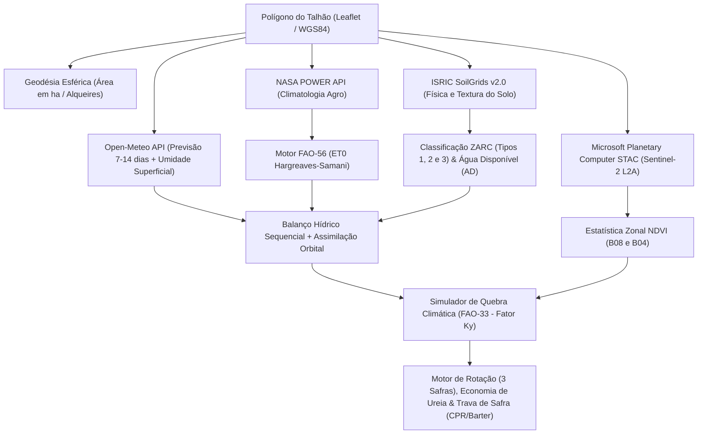

# 🌱 AgroCycle AI — Planejador de Safra, Balanço Hídrico & Vendas Futuras

O **AgroCycle AI** é uma plataforma agrometeorológica, biofísica e financeira *Offline-First* para planejamento de rotação/sucessão de culturas (3 safras), estimativa e previsão de água na raiz (7 a 14 dias), cálculo de quebra climática (**FAO-33**) e simulador de trava de safra / vendas futuras (**CPR, Barter e Contrato Futuro**).

🔗 **Acesse a Aplicação Publicada (GitHub Pages):** [https://gitluiz2026.github.io/NasaSPACE2026/](https://gitluiz2026.github.io/NasaSPACE2026/)  
📄 **Documentação Científica Detalhada:** [DOCS_CIENTIFICO.md](./DOCS_CIENTIFICO.md)

---

## 📁 Estrutura do Repositório (Frontend × Backend)

O projeto separa a camada de interface (**Frontend**) da camada de motores matemáticos, conectores orbitais e API (**Backend**), mantendo o arquivo `index.html` na raiz para funcionamento direto no **GitHub Pages**:

```text
├── index.html                        # Ponto de entrada principal (compatível direto com GitHub Pages)
├── DOCS_CIENTIFICO.md                # Detalhamento completo de extração de dados, fórmulas e embasamento científico
├── .nojekyll                         # Garante que o GitHub Pages sirva todas as pastas sem bloqueios
├── .gitignore                        # Arquivos ignorados pelo Git
├── README.md                         # Documentação principal e científica do sistema
│
├── frontend/                         # CAMADA DE INTERFACE E VISUALIZAÇÃO (UI/UX)
│   ├── css/
│   │   └── styles.css                # Estilos customizados, sliders, mapa responsivo e impressão PDF
│   └── js/
│       └── ui.js                     # Controlador de tela, Mapa Leaflet, Gráficos Chart.js, Wizard e Modais
│
└── backend/                          # CAMADA DE MOTORES AGRONÔMICOS, DADOS ORBITAIS E API
    ├── engine/                       # Motor Serverless / Offline-First (executado no GitHub Pages)
    │   ├── presets.js                # Calibração regional, parâmetros de cultura (Kc, raiz) e economia agrícola
    │   ├── agronomic-engine.js       # Cálculos FAO-56 (ET0), FAO-33 (quebra), ZARC, Ureia e Balanço Hídrico
    │   └── orbital-services.js       # Conectores NASA POWER, Sentinel-2 STAC, SoilGrids v2.0 e Open-Meteo
    └── api/                          # Servidor REST opcional em Python (FastAPI)
        ├── main.py                   # Endpoints REST (/api/health, /api/simulate-futures)
        └── requirements.txt          # Dependências Python
```

---

## 🛰️ Sistemas Utilizados e Pipeline de Extração de Dados

O sistema opera em arquitetura **Offline-First Híbrida**: realiza chamadas assíncronas em tempo real às APIs orbitais/meteorológicas com controle de *timeout* (`AbortController`), cache em `localStorage` e *fallbacks* determinísticos calibrados por região.



### 1. NASA POWER API (Climatologia Agrometeorológica)
- **Módulo**: `backend/engine/orbital-services.js` (`fetchNasaPowerClimatology`)
- **Endpoint**: `https://power.larc.nasa.gov/api/temporal/climatology/point?parameters=T2M,T2M_MIN,PRECTOTCORR,ALLSKY_SFC_SW_DWN&community=AG`
- **Variáveis extraídas**:
  - `T2M` (`ANN`): Temperatura média anual do ar a 2 metros ($\text{°C}$).
  - `T2M_MIN` (`JAN..DEC`): Temperatura mínima mensal a 2 metros ($\text{°C}$), extraindo-se o mínimo absoluto anual ($\min(T_{\min,\text{mês}})$) para risco de geada e aptidão de inverno.
  - `PRECTOTCORR` (`ANN`): Precipitação média diária corrigida ($\text{mm}\cdot\text{dia}^{-1}$), convertida em acumulado anual: $P_{\text{anual}} = \text{round}(\text{PRECTOTCORR}_{\text{ANN}} \times 365)$.
  - `ALLSKY_SFC_SW_DWN` (`ANN`): Irradiação solar global incidente na superfície em céu total ($\text{MJ}\cdot\text{m}^{-2}\cdot\text{dia}^{-1}$).

### 2. Microsoft Planetary Computer STAC & Data API (Sentinel-2 L2A)
- **Módulo**: `backend/engine/orbital-services.js` (`fetchPlanetaryComputerNDVI`) e `frontend/js/ui.js` (`renderNdviMapLayer`)
- **Constelação / Nível**: Copernicus **Sentinel-2 (MSI)** coleção `sentinel-2-l2a` (*Bottom-Of-Atmosphere reflectance*).
- **Extração em 3 etapas**:
  1. **Busca Espaço-Temporal (`POST /api/stac/v1/search`)**: Filtra cenas que intersectam o polígono GeoJSON do talhão nos últimos 180 dias com cobertura de nuvens `eo:cloud_cover < 45%`.
  2. **Estatística Zonal (`POST /api/data/v1/item/statistics`)**: Calcula a média real dentro da geometria do talhão para a expressão `(B08-B04)/(B08+B04)` usando as bandas `B08` (NIR, $842\text{ nm}$, $10\text{ m}$) e `B04` (Red, $665\text{ nm}$, $10\text{ m}$).
  3. **Renderização Raster (`GET /api/data/v1/item/tiles/WebMercatorQuad/{z}/{x}/{y}@1x`)**: Projeta os tiles dinâmicos de NDVI com paleta `rdylgn` sobre o mapa Esri World Imagery.

### 3. ISRIC SoilGrids v2.0 (Propriedades Físico-Hídricas do Solo)
- **Módulo**: `backend/engine/orbital-services.js` (`bonusFetchSoilProperties`)
- **Endpoint**: `https://rest.isric.org/soilgrids/v2.0/properties/query`
- **Extração**: Consulta as profundidades `0-5cm` e `5-15cm` (média ponderada convertida pelo `d_factor` da camada) para:
  - `clay` (% de argila) e `sand` (% de areia);
  - `wv0033` ($\theta_{\text{CC}}$: umidade volumétrica na Capacidade de Campo a $33\text{ kPa}$, em $\text{cm}^3\cdot\text{cm}^{-3}$);
  - `wv1500` ($\theta_{\text{PMP}}$: umidade volumétrica no Ponto de Murcha Permanente a $1500\text{ kPa}$, em $\text{cm}^3\cdot\text{cm}^{-3}$).

### 4. Open-Meteo Forecast & Soil Moisture API
- **Módulo**: `backend/engine/orbital-services.js` (`bonusFetchWeatherData`)
- **Endpoint**: `https://api.open-meteo.com/v1/forecast`
- **Extração**:
  - `daily=precipitation_sum` (precipitação diária, $\text{mm}$);
  - `daily=et0_fao_evapotranspiration` ($\text{ET}_0$ Penman-Monteith FAO-56 diária, $\text{mm}\cdot\text{dia}^{-1}$);
  - `hourly=soil_moisture_0_to_7cm` (umidade volumétrica superficial agregada pela média diária das 24 horas, $\text{m}^3\cdot\text{m}^{-3}$).

---

## 📐 Fórmulas Matemáticas e Modelos Biofísicos Implementados

### 1. Geodésia Esférica (Área do Polígono WGS84) e Conversão Agrária
Implementado em `calculatePolygonAreaHa` (`backend/engine/agronomic-engine.js`) via excesso esférico de Chamberlain & Duquette (NASA/JPL) com raio equatorial $R = 6\,378\,137\text{ m}$:

$$A_{\text{m}^2} = \frac{R^2}{2} \left| \sum_{i=0}^{n-1} (\lambda_{i+1} - \lambda_i) \cdot \left(2 + \sin\phi_i + \sin\phi_{i+1}\right) \right|$$

$$A_{\text{ha}} = \frac{A_{\text{m}^2}}{10\,000}, \quad A_{\text{alq. paulista}} = \frac{A_{\text{ha}}}{2{,}42}, \quad A_{\text{alq. mineiro}} = \frac{A_{\text{ha}}}{4{,}84}$$

### 2. Índice de Vegetação (NDVI) e Estimador Bioclimático de De Martonne
Quando há cena limpa do Sentinel-2 L2A:

$$\text{NDVI} = \frac{\text{B08} - \text{B04}}{\text{B08} + \text{B04}}$$

Na ausência de cena terrestre sem nuvens (`estimateClimateNdvi`), aplica-se o Índice de Aridez bioclimático:

$$I_a = \frac{P_{\text{anual}}}{\max\left(150,\; (T_{\text{méd}} + 10) \times 45\right)}, \quad \text{NDVI}_{\text{clim}} = \text{clamp}\left(0{,}14 + 0{,}48 \cdot I_a,\; 0{,}10,\; 0{,}82\right)$$

### 3. Evapotranspiração de Referência ($\text{ET}_0$) — Hargreaves-Samani (FAO-56)
Implementado em `computeEt0HargreavesSamani` (`backend/engine/agronomic-engine.js`) convertendo a radiação solar $R_s$ em equivalente de evaporação ($\lambda = 2{,}45\text{ MJ}\cdot\text{kg}^{-1}$):

$$\text{ET}_0 = \max\left(1{,}0,\; 0{,}0135 \cdot (T_{\text{méd}} + 17{,}78) \cdot \frac{R_s}{2{,}45}\right) \quad [\text{mm}\cdot\text{dia}^{-1}]$$

$$\text{BH}_{\text{anual}} = P_{\text{anual}} - \left(\text{ET}_0 \times 365\right) \quad [\text{mm}\cdot\text{ano}^{-1}]$$

### 4. Classificação Textural ZARC, Água Disponível ($\text{AD}$) e $\text{CAD}$ Dinâmica
Segundo a normativa do Zoneamento Agrícola de Risco Climático (MAPA / Embrapa):
- **Tipo 3 (Argiloso)**: $\text{Argila} \ge 35\% \implies \text{AD}_{\text{ref}} = 0{,}15\text{ cm}^3\cdot\text{cm}^{-3}$ ($1{,}5\text{ mm/cm}$)
- **Tipo 2 (Médio)**: $15\% \le \text{Argila} < 35\%$ e $\text{Areia} < 85\% \implies \text{AD}_{\text{ref}} = 0{,}11\text{ cm}^3\cdot\text{cm}^{-3}$ ($1{,}1\text{ mm/cm}$)
- **Tipo 1 (Arenoso)**: $\text{Argila} < 15\%$ ou $\text{Areia} \ge 85\% \implies \text{AD}_{\text{ref}} = 0{,}07\text{ cm}^3\cdot\text{cm}^{-3}$ ($0{,}7\text{ mm/cm}$)

Quando extraído diretamente do **SoilGrids v2.0** (`bonusCalculateAD`):

$$\text{AD} = \theta_{\text{CC}\,(33\text{ kPa})} - \theta_{\text{PMP}\,(1500\text{ kPa})}$$

A profundidade efetiva do sistema radicular $Z_r(\text{DAP})$ (em $\text{cm}$) e o coeficiente de cultura $K_c(\text{DAP})$ evoluem conforme os Dias Após o Plantio (`obterParametrosCulturaAgroShield` em `backend/engine/presets.js`), determinando a **Capacidade de Água Disponível ($\text{CAD}_t$)** na zona radicular:

$$\text{CAD}_t = \text{AD} \times Z_r(\text{DAP}_t) \times 10 \quad [\text{mm}]$$

### 5. Balanço Hídrico Sequencial Diário com Assimilação Orbital (*Data Nudging*)
Implementado em `computeAgroShieldDecision` e `bonusRunWaterBalanceSimulation` (`backend/engine/agronomic-engine.js`):

$$\text{ET}_{c,t} = \text{ET}_{0,t} \times K_c(\text{DAP}_t)$$

$$\text{ARM}_{\text{calc},t} = \text{clamp}\left(\text{ARM}_{t-1} + P_t - \text{ET}_{c,t},\; 0,\; \text{CAD}_t\right)$$

Quando a diferença entre o armazenamento modelado ($\text{ARM}_{\text{calc},t}$) e o armazenamento derivado da umidade orbital ($\text{ARM}_{\text{sat},t}$) supera $20\%$ da $\text{CAD}_t$, aplica-se o filtro de assimilação de dados ($70\%$ modelo físico + $30\%$ leitura de satélite):

$$\text{ARM}_t = 0{,}70 \cdot \text{ARM}_{\text{calc},t} + 0{,}30 \cdot \text{ARM}_{\text{sat},t}$$

O gatilho de estresse hídrico é acionado quando o armazenamento atinge o limite crítico de depleção ($\text{ARM}_t \le 0{,}50 \cdot \text{CAD}_t$).

### 6. Modelo de Quebra de Safra por Estresse Climático (FAO-33)
Baseado na equação de resposta da produtividade à água de Doorenbos & Kassam (**FAO Irrigation and Drainage Paper 33**), implementada em `computeFao33YieldPreservation` (`backend/engine/agronomic-engine.js`) e `compute_fao33_preservation` (`backend/api/main.py`):

$$1 - \frac{Y_a}{Y_m} = K_y \cdot \left(1 - \frac{\text{ET}_a}{\text{ET}_c}\right) \implies \text{Preservação (\%)} = \left[1 - K_y \cdot \left(1 - \frac{\text{ET}_a}{\text{ET}_c}\right)\right] \times 100$$

Onde a razão de atendimento hídrico em sequeiro incorpora o choque de chuva ($\Delta P_{\%}$), o efeito protetor da palhada na redução da evaporação do solo ($M_{\text{mulch}}$) e o aumento da demanda atmosférica pelo aquecimento ($\Delta T$):

$$\frac{\text{ET}_a}{\text{ET}_c} = \text{clamp}\left(\left(1 + \frac{\Delta P_{\%}}{100}\right) \cdot \left(1 + 0{,}38 \cdot M_{\text{mulch}}\right) \cdot \frac{\text{ET}_0(T_{\text{base}})}{\text{ET}_0(T_{\text{base}} + \Delta T)},\; 0{,}35,\; 1{,}00\right)$$

- **Parâmetros por Sistema de Manejo**:
  - **Plano Equilibrado**: $K_y = 0{,}92$, $M_{\text{mulch}} = 0{,}35$, tolerância a geada $T_{\text{frost}} = 0{,}72$.
  - **Plano Venda Rápida**: $K_y = 1{,}18$, $M_{\text{mulch}} = 0{,}05$, $T_{\text{frost}} = 0{,}35$.
  - **Plano Proteção Máxima (Blindagem)**: $K_y = 0{,}80$, $M_{\text{mulch}} = 0{,}45$, $T_{\text{frost}} = 0{,}85$.
  - **Solo Descoberto (Referência de Perda Evitada)**: $K_y = 1{,}25$, $M_{\text{mulch}} = 0{,}00$, $T_{\text{frost}} = 0{,}25$.

### 7. Ciclagem Biológica de Nitrogênio e Economia em Ureia
Implementado em `computeUreaSavingsBrl` considerando taxa de mineralização/aproveitamento de $50\%$ do N fixado ($N_{\text{fix}}$), teor de $45\%$ de N na ureia comercial e preço de $\text{R\$ } 3{,}20\text{/kg}$ de ureia:

$$\text{Economia Ureia (R\$/ha)} = \text{round}\left( \frac{N_{\text{fix}} \times 0{,}50}{0{,}45} \times 3{,}20 \right)$$

### 8. Simulador de Vendas Futuras (CPR / Barter), Break-Even e Limite Anti-Washout
Implementado em `calculateScenarioLossAndFutures` (`frontend/js/ui.js`) e `/api/simulate-futures` (`backend/api/main.py`):
- **Ponto de Equilíbrio (*Break-Even*)**:
  $$\text{Break-Even (unid/ha)} = \frac{C_{\text{bruto/ha}} - \text{Economia Ureia}_{\text{R\$/ha}}}{P_{\text{unid}}}$$
- **Limite Prudencial de Trava Futura (*Anti-Washout*)**: Indexado a $65\%$ da resiliência climática FAO-33 (em múltiplos de $5\%$) para evitar inadimplência física (*washout*) em caso de veranico:
  $$H_{\text{seguro,\%}} = \text{clamp}\left(\text{round}\left(\frac{\text{Preservação}_{\%} \times 0{,}65}{5}\right) \times 5,\; 20\%,\; 70\%\right)$$

---

## 📚 Embasamento Científico e Links Oficiais (NASA & Agências Parceiras)

### 🛰️ 1. Portais, Missões e Publicações Oficiais da NASA (`nasa.gov`)

1. **NASA POWER — Prediction Of Worldwide Energy Resources (MERRA-2 & CERES)**
   - **Portal Oficial NASA**: [https://power.larc.nasa.gov/](https://power.larc.nasa.gov/)
   - **Documentação Metodológica Agroclimatológica**: [https://power.larc.nasa.gov/docs/methodology/](https://power.larc.nasa.gov/docs/methodology/)
   - **Endpoint Consumido**: `https://power.larc.nasa.gov/api/temporal/climatology/point?parameters=T2M,T2M_MIN,PRECTOTCORR,ALLSKY_SFC_SW_DWN&community=AG`
   - **Referência**: SPARKS, A. H. *nasapower: a NASA POWER Global Meteorology, Surface Solar Energy and Climatology Data Client*. **Journal of Open Source Software**, v. 3, n. 30, p. 1035, 2018.

2. **NASA NTRS — Publicação Original da Fórmula do NDVI (`NASA SP-351`)**
   - **Documento Oficial no Servidor Técnico da NASA**: [https://ntrs.nasa.gov/citations/19740022614](https://ntrs.nasa.gov/citations/19740022614)
   - **Referência**: ROUSE, J. W. et al. *Monitoring vegetation systems in the Great Plains with ERTS*. **Third Earth Resources Technology Satellite-1 Symposium**, NASA SP-351, p. 309–317, 1974.

3. **NASA JPL — Geodésia Esférica para Cálculo de Área de Polígonos (`JPL Publication 07-03`)**
   - **Repositório Técnico NASA Jet Propulsion Laboratory**: [https://trs.jpl.nasa.gov/handle/2014/40409](https://trs.jpl.nasa.gov/handle/2014/40409)
   - **Referência**: CHAMBERLAIN, R. G.; DUQUETTE, W. H. *Some algorithms for polygons on a sphere*. **JPL Publication 07-03**, Jet Propulsion Laboratory, NASA, Pasadena, CA, 2007.

4. **NASA SMAP — Soil Moisture Active Passive & Assimilação Orbital**
   - **Portal Oficial da Missão no NASA JPL**: [https://smap.jpl.nasa.gov/](https://smap.jpl.nasa.gov/)
   - **NASA Earthdata Agriculture & Water**: [https://www.earthdata.nasa.gov/](https://www.earthdata.nasa.gov/)

---

### 🌍 2. Agências Científicas, Orbitais e Normativas Parceiras (FAO, ESA, ISRIC & Embrapa)

5. **FAO / ONU — Evapotranspiração ($\text{ET}_0$, $K_c$) e Resposta da Produtividade à Água (Fator $K_y$)**
   - **Portal Oficial FAO Land & Water**: [https://www.fao.org/land-water/databases-and-software/crop-information/en/](https://www.fao.org/land-water/databases-and-software/crop-information/en/)
   - **FAO-56**: ALLEN, R. G.; PEREIRA, L. S.; RAES, D.; SMITH, M. *Crop evapotranspiration — Guidelines for computing crop water requirements*. **FAO Irrigation and Drainage Paper 56**. Rome: FAO, 1998. ([Texto Oficial FAO-56](https://www.fao.org/4/x0490e/x0490e00.htm))
   - **Hargreaves-Samani**: HARGREAVES, G. H.; SAMANI, Z. A. *Reference crop evapotranspiration from temperature*. **Applied Engineering in Agriculture**, v. 1, n. 2, p. 96–99, 1985.
   - **FAO-33 & FAO-66**: DOORENBOS, J.; KASSAM, A. H. *Yield response to water*. **FAO Irrigation and Drainage Paper 33**, 1979; STEDUTO, P. et al. **FAO Paper 66**, 2012. ([Portal FAO-66](https://www.fao.org/4/i2800e/i2800e00.htm))

6. **ESA Copernicus Sentinel-2 L2A & Microsoft Planetary Computer STAC**
   - **Catálogo Oficial STAC Sentinel-2 L2A**: [https://planetarycomputer.microsoft.com/dataset/sentinel-2-l2a](https://planetarycomputer.microsoft.com/dataset/sentinel-2-l2a)
   - **Portal ESA Sentinel-2**: [https://sentiwiki.copernicus.eu/web/s2-mission](https://sentiwiki.copernicus.eu/web/s2-mission)
   - **Referência**: DRUSCH, M. et al. *Sentinel-2: ESA's Optical High-Resolution Mission for GMES Operational Services*. **Remote Sensing of Environment**, v. 120, p. 25–36, 2012.

7. **ISRIC World Soil Information — SoilGrids v2.0 (Retenção Hídrica 33 kPa e 1500 kPa)**
   - **Portal Oficial SoilGrids**: [https://soilgrids.org/](https://soilgrids.org/)
   - **Documentação da API ISRIC**: [https://www.isric.org/explore/soilgrids/faq-soilgrids](https://www.isric.org/explore/soilgrids/faq-soilgrids)
   - **Referência**: POGGIO, L. et al. *SoilGrids 2.0: producing soil information for the globe with quantified spatial uncertainty*. **Soil**, v. 7, n. 1, p. 217–240, 2021. ([Artigo Oficial](https://soil.copernicus.org/articles/7/217/2021/))

8. **Embrapa & MAPA — Zoneamento Agrícola de Risco Climático (ZARC) e Fixação Biológica de N**
   - **Portal Oficial ZARC (MAPA)**: [https://www.gov.br/agricultura/pt-br/assuntos/riscos-seguro/programa-nacional-de-zoneamento-agricola-de-risco-climatico](https://www.gov.br/agricultura/pt-br/assuntos/riscos-seguro/programa-nacional-de-zoneamento-agricola-de-risco-climatico)
   - **Embrapa Solos (Grupos de Terra ZARC)**: [https://www.embrapa.br/solos](https://www.embrapa.br/solos) — TEIXEIRA, W. G. et al. *Retenção de água no solo e classificação em grupos de disponibilidade hídrica para o ZARC*, 2021.
   - **Embrapa Soja (FBN e Economia de Ureia)**: [https://www.embrapa.br/soja](https://www.embrapa.br/soja) — HUNGRIA, M.; CAMPO, R. J.; MENDES, I. C. *A importância do processo de fixação biológica do nitrogênio para a cultura da soja*. Documentos 283, 2007.

9. **Open-Meteo API (Previsão Meteorológica e Umidade Superficial Diária)**
   - **Documentação Oficial Open-Meteo**: [https://open-meteo.com/en/docs](https://open-meteo.com/en/docs)

